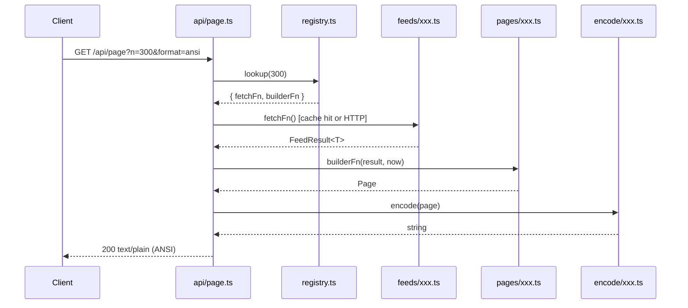
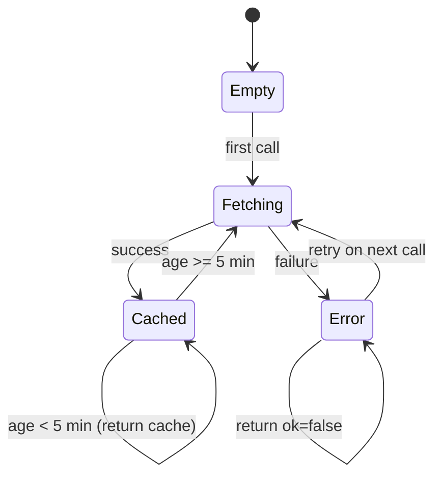
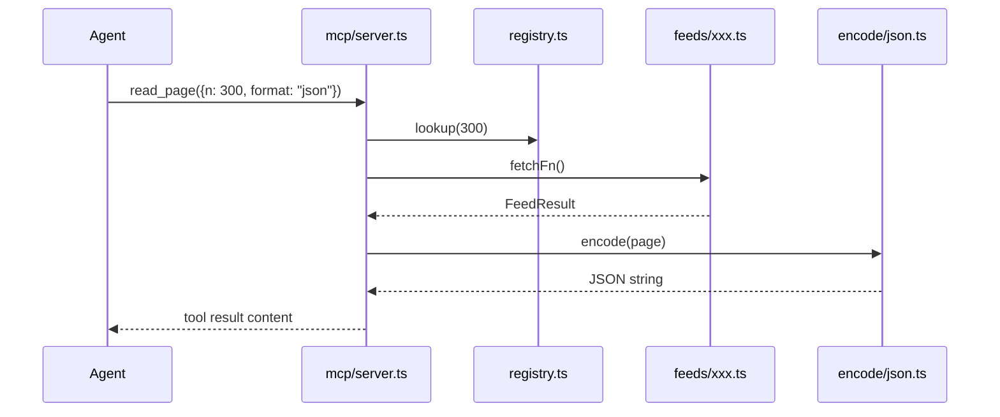

# CRYPTEXT: Design

## 1. Architecture Overview

CRYPTEXT is a three-layer system:

```
 ┌──────────────────────────────────────────────────────────┐
 │                      Clients                             │
 │   Browser (CRT viewer)  │  Terminal (curl)  │  AI Agent  │
 └──────────┬──────────────┴────────┬──────────┴─────┬──────┘
            │ HTTP GET              │ HTTP GET        │ stdio MCP
            ▼                       ▼                 ▼
 ┌──────────────────────┐   ┌──────────────────────────────┐
 │  Vercel Functions    │   │    mcp/server.ts             │
 │  api/page.ts         │   │  (@modelcontextprotocol/sdk) │
 │  api/pages.ts        │   │  tools: list_pages, read_page│
 └──────────┬───────────┘   └──────────────┬───────────────┘
            │                              │
            ▼                              ▼
 ┌─────────────────────────────────────────────────────────┐
 │                  src/registry.ts                        │
 │      pageNumber → (fetchFn, builderFn) entries          │
 └──────────────────────────┬──────────────────────────────┘
                            │
            ┌───────────────┼──────────────────┐
            ▼               ▼                  ▼
 ┌─────────────────┐ ┌─────────────┐ ┌────────────────────┐
 │  src/feeds/     │ │ src/pages/  │ │   src/encode/      │
 │  nws.ts         │ │ weather.ts  │ │   html.ts          │
 │  usgs.ts        │ │ quake.ts    │ │   ansi.ts          │
 │  swpc.ts        │ │ space.ts    │ │   json.ts          │
 │  treasury.ts    │ │ money.ts    │ │   tti.ts           │
 │  usaspending.ts │ │ govt.ts     │ └────────────────────┘
 │  fedregister.ts │ │ safety.ts   │
 │  openfda.ts     │ │ tech.ts     │
 │  hackernews.ts  │ │ index.ts    │
 └─────────────────┘ │ about.ts    │
                     │ kiroween.ts │
                     └─────────────┘
                            │
                            ▼
                 ┌──────────────────┐
                 │  src/engine/     │
                 │  page.ts         │
                 │  codes.ts        │
                 │  helpers.ts      │
                 │  mosaic.ts       │
                 └──────────────────┘
```

### Key invariants

1. **Pure pages**: page builders are `(data, now: Date) => Page`. No I/O.
2. **Feeds isolated**: all HTTP happens inside `src/feeds/`. Results are
   cached in module scope.
3. **Grid immutable**: the `Page` grid is a `Uint8Array[25][40]`. Engine
   helpers clip every write. No encoder should mutate the grid.
4. **Zero runtime deps** outside `@modelcontextprotocol/sdk` (MCP only).

---

## 2. Data Flow

### 2.1 HTTP request (browser / curl)



### 2.2 Feed cache state machine



### 2.3 MCP call



---

## 3. Module Interfaces

### 3.1 `src/engine/page.ts`

```typescript
// 7-bit cell value
type Cell = number; // 0x00–0x7F

interface FastextLinks {
  red?:   number; // 100–899
  green?: number;
  yellow?: number;
  cyan?:  number;
}

interface Page {
  readonly number:  number;          // 3-digit page number
  readonly grid:    Uint8Array[];    // 25 rows × 40 cols
  readonly title:   string;         // used by index
  fastext:          FastextLinks;
  fetchedAt?:       string;         // ISO-8601 from feed
  source?:          string;         // feed source name/URL
}

function makePage(number: number, title: string): Page
```

### 3.2 `src/engine/codes.ts`

```typescript
// Alpha colour codes 0x01–0x07
export const RED = 0x01, GREEN = 0x02, YELLOW = 0x03,
             BLUE = 0x04, MAGENTA = 0x05, CYAN = 0x06, WHITE = 0x07;

// Mosaic colour codes 0x11–0x17
export const MOSAIC_RED = 0x11, /* … */ MOSAIC_WHITE = 0x17;

// Other attributes
export const FLASH = 0x08, STEADY = 0x09,
             NORMAL_HEIGHT = 0x0C, DOUBLE_HEIGHT = 0x0D,
             CONCEAL = 0x18, CONTIGUOUS_MOSAIC = 0x19,
             SEPARATED_MOSAIC = 0x1A,
             BLACK_BACKGROUND = 0x1C, NEW_BACKGROUND = 0x1D,
             HOLD_MOSAICS = 0x1E, RELEASE_MOSAICS = 0x1F;

// Colour RGB values for encoders
export const COLOUR_RGB: Record<number, [number, number, number]>
```

### 3.3 `src/engine/helpers.ts`

```typescript
// Write a string starting at (row, col); clips at col 39
function writeText(page: Page, row: number, col: number,
                   text: string, attrBefore?: number): void

// Write with padding/alignment inside a fixed-width field
function writePadded(page: Page, row: number, col: number,
                     text: string, width: number,
                     align: 'left'|'right'|'center',
                     attrBefore?: number): void

// Write the standard header row (row 0):
//   page number left, title centre, clock right
function writeHeader(page: Page, now: Date): void

// Write the standard source footer on row 24
function writeSource(page: Page, source: string): void

// Write a SERVICE INTERRUPTED panel (rows 10–15 centred)
function writeInterrupted(page: Page, source: string, error: string): void
```

### 3.4 `src/engine/mosaic.ts`

```typescript
// Encode a 0–6 fractional height into a sextant byte (bit 5 always set)
function sextantByte(topLeft: boolean, topRight: boolean,
                     midLeft: boolean, midRight: boolean,
                     botLeft: boolean, botRight: boolean): number

// Write a single-column mosaic bar of height h (0–6 sextant units)
function mosaicBar(page: Page, row: number, col: number,
                   height6: number, colourCode: number): void

// Write a sparkline across `width` columns from a series of values
function sparkline(page: Page, row: number, col: number,
                   values: number[], width: number,
                   colourCode: number): void
```

### 3.5 `src/encode/html.ts`

```typescript
// Returns an HTML string (full document or fragment)
export function encodeHtml(page: Page): string
```

Rendering rules:
- Each row is a `<div class="row [double-height] [blank-row]">`.
- Each cell group sharing the same attributes is a `<span class="fg-X bg-Y [flash] [conceal]">`.
- Mosaic character spans carry `data-sextants="0b…"` and contain six
  `<span class="sx">` children for CSS block rendering.
- Double-height row sets `class="dh-top"`; the blank row below sets
  `class="dh-bottom"` and is rendered empty.

### 3.6 `src/encode/ansi.ts`

```typescript
export function encodeAnsi(page: Page, stripCodes?: boolean): string
```

Rendering rules:
- Start each row with `\x1b[0m` reset.
- Emit `\x1b[38;2;R;G;Bm` on foreground colour change.
- Emit `\x1b[48;2;R;G;Bm` on background colour change.
- Map mosaic sextants to the nearest Unicode block character from the
  "Symbols for Legacy Computing" block (U+1FB00–U+1FB3B) where available,
  falling back to `▌`, `▐`, `█`, `░`.
- Emit `\x1b[5m` for FLASH.
- `stripCodes=true` returns plain 25-line × 40-char text.

## API Endpoint Notes

Several endpoints required adjustments from original design:
- **Treasury**: Using `/v1/accounting/od/debt_to_penny` (simplified structure)
- **USAspending**: Using `/api/v2/awards/` (public browse endpoint) instead of search
- These endpoints return compatible data; see `fixtures/` for recorded examples.

### 3.7 `src/encode/json.ts`

```typescript
interface JsonCell {
  char:         string;   // single UTF-16 character
  code:         number;   // raw 7-bit value
  fg:           string;   // "white" | "red" | …
  bg:           string;
  flash:        boolean;
  conceal:      boolean;
  doubleHeight: boolean;
  mosaic:       boolean;
  sextantBits?: number;   // 0–63, only when mosaic=true
}

interface JsonRow {
  text:  string;    // 40-char plain text (attrs → space)
  cells: JsonCell[];
}

interface JsonPage {
  pageNumber:   number;
  title:        string;
  fetchedAt?:   string;
  source?:      string;
  rows:         JsonRow[];  // always 25 elements
  fastextLinks: FastextLinks;
}

export function encodeJson(page: Page): string   // JSON.stringify(JsonPage)
```

### 3.8 `src/encode/tti.ts`

```typescript
export function encodeTti(page: Page): string

// Internal: round-trip parser for testing only
export function parseTti(tti: string): Uint8Array[]  // 25×40 grid
```

TTI line format:
```
DE,CRYPTEXT
PN,<mag><page>00        e.g. PN,30000 for page 300
SC,0000
PS,8000
OL,0,<row0-escaped>
…
OL,24,<row24-escaped>
FL,<red>,<green>,<yellow>,<cyan>,8ff,100
```
Control codes 0x00–0x1F in `OL` lines are escaped as `ESC (code+0x40)`.
`ESC` itself (0x1B) is encoded as `ESC ` followed by `0x5B` (`[`).

### 3.9 `src/feeds/*.ts` (each feed module)

```typescript
// Common cache wrapper (shared utility in src/feeds/_cache.ts)
interface CacheEntry<T> {
  result:     FeedResult<T>;
  cachedAt:   number;   // Date.now()
}

// FeedResult<T>
type FeedResult<T> =
  | { ok: true;  data: T; fetchedAt: string; source: string }
  | { ok: false; error: string; source: string };

// Each feed exports one function, e.g.:
export async function fetchWeather(): Promise<FeedResult<WeatherData>>
export async function fetchQuakes():  Promise<FeedResult<QuakeData>>
// … etc.
```

Cache logic (in `_cache.ts`):
```typescript
const TTL = 5 * 60 * 1000; // 5 minutes

export function withCache<T>(
  key: string,
  fetcher: () => Promise<FeedResult<T>>
): () => Promise<FeedResult<T>>
```

### 3.10 `src/registry.ts`

```typescript
interface RegistryEntry {
  title:   string;
  fetch:   () => Promise<FeedResult<unknown>>;
  build:   (data: FeedResult<unknown>, now: Date) => Page;
}

const registry = new Map<number, RegistryEntry>();

export function lookupPage(n: number): RegistryEntry | undefined
export function allPages(): Array<{ n: number; title: string }>
```

### 3.11 `api/page.ts` (Vercel function)

```typescript
// Handler signature for Vercel Edge/Node
export default async function handler(req, res) {
  const n      = parseInt(req.query.n);
  const format = req.query.format ?? 'html';
  const entry  = lookupPage(n);
  if (!entry) return res.status(404).json({ error: 'Page not found' });
  const feedResult = await entry.fetch();
  const page       = entry.build(feedResult, new Date());
  switch (format) {
    case 'html':  return res.send(encodeHtml(page));
    case 'ansi':  return res.send(encodeAnsi(page));
    case 'json':  return res.json(JSON.parse(encodeJson(page)));
    case 'tti':   return res.send(encodeTti(page));
    default:      return res.status(400).json({ error: 'Invalid format' });
  }
}
```

### 3.12 `mcp/server.ts`

Uses `@modelcontextprotocol/sdk` `Server` class over `StdioServerTransport`.

Tools:
- `list_pages` – no args → returns `allPages()` as JSON text.
- `read_page` – args `{ n: number, format?: "json"|"ansi"|"tti" }` →
  runs the registry pipeline and returns the encoded string.

---

## 4. Teletext Level 1 Attribute State Machine

Within each row the renderer walks cells left-to-right maintaining:

```
state = {
  fg:           WHITE (0x07),
  bg:           BLACK,
  mosaic:       false,
  flash:        false,
  doubleHeight: false,
  conceal:      false,
  holdMosaic:   false,
  contiguous:   true,
}
```

| Code | Effect |
|------|--------|
| 0x01–0x07 | `fg = code`; `mosaic = false` |
| 0x08 | `flash = true` |
| 0x09 | `flash = false` |
| 0x0C | `doubleHeight = false` |
| 0x0D | `doubleHeight = true` (engine blanks row+1) |
| 0x11–0x17 | `fg = code`; `mosaic = true` |
| 0x18 | `conceal = true` |
| 0x19 | `mosaic = true`; `contiguous = true` |
| 0x1A | `mosaic = true`; `contiguous = false` |
| 0x1C | `bg = BLACK` |
| 0x1D | `bg = current fg` |
| 0x1E | `holdMosaic = true` |
| 0x1F | `holdMosaic = false` |

State resets to defaults at the start of every row. This state machine is
implemented once in `src/engine/helpers.ts` as `walkRow()` and reused by
all four encoders to avoid duplication.

---

## 5. Error Handling

| Scenario | Behaviour |
|----------|-----------|
| Feed HTTP timeout | Return `ok: false` after a 10-second timeout |
| Feed parse error | Catch JSON/schema errors; return `ok: false` |
| Feed returns stale cache | Add `stale: true` to `ok: true` result |
| Page builder receives `ok: false` | Call `writeInterrupted()` helper |
| Unknown page number in API | Return HTTP 404 |
| Invalid format in API | Return HTTP 400 |
| Encoder receives edge-case page | Must not throw (property-tested) |
| MCP read_page unknown page | Return MCP tool error, not process exit |
| NWS single city unreachable | Mark that city N/A; whole feed still `ok: true` |
| HN story detail fetch fails | Omit that story; partial list still returned |

---

## 6. Page Layout Conventions

### Header (row 0)
```
|P300    CRYPTEXT    01 NOV 2026 06:00|
```
- Cols 0–2: page number (3 chars, right-padded)
- Cols 4–35: service name, centred
- Cols 32–39: date + time, right-aligned

### Source footer (row 24)
```
|earthquake.usgs.gov              ████|
```
- Source text left-aligned cols 0–35 in CYAN
- Fastext colour squares cols 36–39 (one per link)

### Fastext link squares
Standard Teletext fastext footer pattern on row 24 cols 36–39:
`[R][G][Y][C]`: coloured blocks. Navigation target encoded in the
`FastextLinks` struct rather than on the page grid.

---

## 7. Mosaic Encoding Reference

Sextant cell layout (ETS 300 706):
```
 bit 0 │ bit 1
 bit 2 │ bit 3
 bit 4 │ bit 6   ← note: bit 5 is always 1 (set) to keep codes >= 0x20
```

Byte formula: `(bits | 0x20)` where bits is `b0 + 2*b1 + 4*b2 + 8*b3 + 16*b4 + 64*b6`.

Codes 0x40–0x5F are alpha characters even in graphics mode ("alpha lock");
the mosaic helpers skip those positions when building bars.

---

## 8. Feed Data Types

```typescript
// NWS
interface WeatherData {
  cities: Array<{
    name: string; state: string;
    temp: number | null; unit: string;
    forecast: string[];             // up to 7 period names
    alerts: Array<{ headline: string; severity: string }>;
  }>;
}

// USGS
interface QuakeData {
  quakes: Array<{
    mag: number; place: string;
    time: number;                   // Unix ms
    depth: number;                  // km
    url: string;
  }>;
  count: number;
}

// NOAA SWPC
interface SpaceWeatherData {
  kpCurrent: number;
  kpHistory: Array<{ time: string; kp: number }>;  // 24 hours
  auroraLatitude: number;          // degrees
  stormLevel: string;              // "None" | "G1" … "G5"
}

// Treasury
interface FiscalData {
  debtToThePenny: string;          // e.g. "35,123,456,789,012.34"
  averageInterestRate: number;     // percent
  rateDate: string;                // ISO-8601 date
}

// USAspending
interface SpendingData {
  awards: Array<{
    recipient: string;
    amount: number;
    agency: string;
    awardType: string;
    date: string;
  }>;
}

// Federal Register
interface FedRegData {
  documents: Array<{
    title: string;
    type: string;                   // "Rule" | "Notice" | …
    agency: string;
    documentNumber: string;
    publicationDate: string;
  }>;
  count: number;
}

// openFDA
interface RecallData {
  food: Array<RecallItem>;
  drug: Array<RecallItem>;
}
interface RecallItem {
  recallNumber: string;
  product: string;
  firm: string;
  classification: string;           // "Class I" | "Class II" | "Class III"
  initiationDate: string;
}

// Hacker News
interface HNData {
  stories: Array<{
    id: number;
    title: string;
    score: number;
    descendants: number;           // comment count
    by: string;
  }>;
}
```

---

## 9. Testing Strategy

### 9.1 Unit tests (`tests/*.test.ts`)

| Suite | What is tested |
|-------|----------------|
| `engine.test.ts` | `writeText` clipping, `writePadded` alignment, `mosaicBar` sextant bytes, `sparkline` scaling |
| `codes.test.ts` | All named constants have expected values; double-height blanks next row |
| `encoders.test.ts` | Each encoder with a known fixture; HTML class names, ANSI sequences, JSON schema, TTI OL format |
| `feeds.test.ts` | Cache TTL logic (using fake timers); `withCache` returns stale on failure |
| `pages.test.ts` | Each page builder returns 25×40 with `ok:false` data (SERVICE INTERRUPTED) |
| `registry.test.ts` | All registered page numbers resolve; `allPages()` sorted ascending |

### 9.2 Property tests (`tests/*.prop.ts`)

| Property | Generator | Assertion |
|----------|-----------|-----------|
| Grid invariant | Random (row, col, text) write operations | `page.grid.length === 25` and `every row.length === 40` |
| No encoder throws | Random valid `Page` (rows/cols filled with 0x20–0x7F and random attributes) | All four encoders complete without exception |
| TTI round-trip | Random valid `Page` | `parseTti(encodeTti(page))` equals `page.grid` byte-for-byte |
| Double-height row blank | Random row index 0–23, place `DOUBLE_HEIGHT` | `page.grid[r+1]` is all 0x20 |
| Cell values 7-bit | Random byte writes | All cells satisfy `cell & 0x80 === 0` |

### 9.3 Correctness properties (summary)

These are the non-negotiable invariants the test suite enforces:

1. **Grid shape**: `page.grid` is always exactly 25 × 40: never ragged.
2. **7-bit clean**: No cell value has bit 7 set.
3. **Double-height**: Row *r+1* is blank whenever `DOUBLE_HEIGHT` is on row *r*.
4. **Encoder safety**: All four encoders handle any valid `Page` without throwing.
5. **TTI round-trip**: `parseTti(encodeTti(p)).grid === p.grid`.
6. **Feed contract**: Feed functions never throw; `ok:false` is always catchable.
7. **Builder purity**: Same `(data, now)` inputs produce identical `Page` objects.

---

## 10. File Layout

```
cryptext/
├── package.json               (type: module, vitest config)
├── tsconfig.json              (strict, ESM, target ES2022)
├── vercel.json                (routes: /api/* → api/)
├── src/
│   ├── engine/
│   │   ├── page.ts            (Page type, makePage)
│   │   ├── codes.ts           (all control code constants + COLOUR_RGB)
│   │   ├── helpers.ts         (writeText, writePadded, writeHeader,
│   │   │                       writeSource, writeInterrupted, walkRow)
│   │   └── mosaic.ts          (sextantByte, mosaicBar, sparkline)
│   ├── encode/
│   │   ├── html.ts
│   │   ├── ansi.ts
│   │   ├── json.ts
│   │   └── tti.ts
│   ├── feeds/
│   │   ├── _cache.ts          (withCache utility)
│   │   ├── _http.ts           (fetch wrapper with User-Agent + timeout)
│   │   ├── nws.ts
│   │   ├── usgs.ts
│   │   ├── swpc.ts
│   │   ├── treasury.ts
│   │   ├── usaspending.ts
│   │   ├── fedregister.ts
│   │   ├── openfda.ts
│   │   └── hackernews.ts
│   ├── pages/
│   │   ├── index.ts           (page 100)
│   │   ├── about.ts           (page 101)
│   │   ├── weather.ts         (pages 200–209)
│   │   ├── quake.ts           (pages 300–302)
│   │   ├── space.ts           (pages 400–401)
│   │   ├── money.ts           (pages 500–503)
│   │   ├── govt.ts            (pages 600–601)
│   │   ├── safety.ts          (pages 700–701)
│   │   ├── tech.ts            (pages 800–801)
│   │   └── kiroween.ts        (page 666)
│   └── registry.ts
├── api/
│   ├── page.ts                (GET /api/page)
│   └── pages.ts               (GET /api/pages)
├── mcp/
│   └── server.ts
├── public/
│   ├── index.html
│   ├── viewer.css             (CRT look: scanlines, glow, curvature)
│   └── viewer.js              (remote control, keyboard, fetch, P counter)
└── tests/
    ├── engine.test.ts
    ├── codes.test.ts
    ├── encoders.test.ts
    ├── feeds.test.ts
    ├── pages.test.ts
    ├── registry.test.ts
    ├── engine.prop.ts
    ├── encoders.prop.ts
    └── helpers/
        └── fixtures.ts        (known test pages)
```

---

## 11. Deployment

- **Vercel**: `vercel.json` routes all `/api/*` to serverless Node 22
  functions. `public/` is served as static files.
- **Local dev**: `npx serve public` for viewer + `vercel dev` for functions.
  No webpack, no bundler.
- **MCP**: `node mcp/server.ts` as a stdio process, configured in any
  MCP-capable agent host.
- **Broadcast**: `node scripts/exportTti.ts` dumps all pages to `.tti` files
  for use with VBIT2 on a Raspberry Pi.
